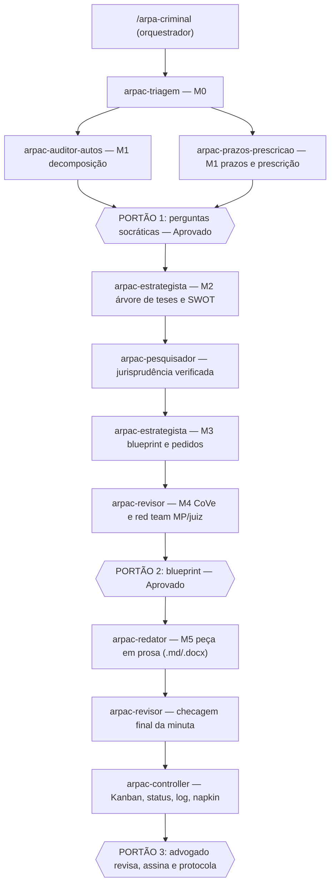

# ARPA-Criminal (ARPA-C)

**Arquitetura de Redação Processual Algorítmica — Criminal.** Adaptação penal do protocolo ARPA cível, distribuída em múltiplos agentes do Claude Code e integrada à gestão do escritório (processos, pessoas, escritório e automação com IA), com base nos cadernos do NotebookLM.

> A IA analisa, organiza e minuta. **Quem assina e protocola é sempre o advogado responsável.** Toda citação de precedente marcada `[REQUER CONSULTA AO SISTEMA DE PRECEDENTES]` ou `[VERIFICAR REDAÇÃO VIGENTE]` precisa ser conferida antes do uso.

## Como funciona



Modos: **Completo** (padrão), **Urgente** (réu preso, flagrante, prazo < 48h), **Revisão de minuta** (você já tem a peça) e **Gestão** (painel, distribuição de tarefas, KPIs). Detalhes em `skills/arpa-criminal/SKILL.md`.

## O que tem no pacote

| Pasta | Conteúdo |
|---|---|
| `prompt-core/ARPA-CRIMINAL.md` | O "prompt core" penal, no mesmo formato do ARPA cível: persona, 5 módulos, Deep Reasoning Protocol penal, catálogo de skills, guardrails de jurisprudência, regras de estilo e caso de referência fictício. Serve para colar em um Projeto do claude.ai ou como base do `CLAUDE.md`. |
| `skills/` | 11 skills novas (abaixo). |
| `agents/` | 8 subagentes do Claude Code (`arpac-*`). |
| `templates/` | Vault do escritório: `CLAUDE.md`, `SCHEMA.md` (INGEST/QUERY/LINT), `Shared/` (escritório, estilo, painel Kanban, equipe, calendário, conhecimento) e `caso-modelo/` com todos os arquivos de handoff. |
| `notebooklm/cadernos.md` | Ligação dos 4 cadernos (automação com IA, gestão de pessoas, gestão de processos, gestão de escritórios) aos agentes, com as perguntas-padrão de cada um. |
| `SPEC.md` | Contrato comum: nomes, gatilhos, arquivos e regras. |

### Skills novas

| Gatilho | Para quê |
|---|---|
| `/arpa-criminal` (`/arpac`) | Orquestra a esteira multiagente e os 3 portões |
| `/decomposicao-penal` | Fatos atômicos, Matriz Penal de Provas (art. 155/156 CPP), inépcia e correlação da denúncia |
| `/prazos-penais` | Prazos do CPP (art. 798, 798-A, Súmulas 310 e 710 STF), JECRIM, LEP, Tribunais Superiores |
| `/dosimetria` · `/prescricao` | Dosimetria trifásica, regime, substituição, sursis e cálculo de prescrição |
| `/provas-nulidades` | Provas ilícitas, cadeia de custódia, reconhecimento (art. 226), busca domiciliar, prova digital, nulidades |
| `/liberdade` | Flagrante, custódia, preventiva (revisão de 90 dias), cautelares, domiciliar, HC |
| `/negocial` | ANPP, transação, sursis processual, colaboração premiada — com análise de custo-benefício |
| `/gestao-processos` | Macroprocesso criminal, Kanban, POPs, SLAs, controladoria de prazos |
| `/gestao-pessoas` | RACI, delegação, revisão em duas camadas, rituais, feedback, carga |
| `/gestao-escritorio` | Atendimento, conflito entre corréus, honorários por fase, LGPD, KPIs |
| `/automacao` | PJe → Docling → mapa dos autos → wiki do caso → ARPA-C → .docx; Obsidian e NotebookLM |

As skills temáticas que você já tem (`/lei-de-drogas`, `/crimes-contra-vida`, `/maria-da-penha`, `/recursos-penais`, `/execucao-penal`, `/superiores` etc.) são acionadas pelo orquestrador conforme o tipo penal e não foram alteradas. Atenção: `/prazos` e `/decomposicao` atuais são cíveis; no crime o ARPA-C usa `/prazos-penais` e `/decomposicao-penal`.

## Instalação

### No Claude Code do seu computador (multiagente completo)

```bash
git clone -b claude/arpa-criminal https://github.com/drjackhub/AprendendoPython.git
cd AprendendoPython/arpa-criminal
./instalar.sh ~/caminho/do/vault-criminal   # instala skills e agentes em ~/.claude e copia os templates
cd ~/caminho/do/vault-criminal
cp -R caso-modelo casos/<CNJ-ou-apelido>     # abre um caso; coloque os autos em raw/
claude                                       # e digite: /arpac casos/<CNJ-ou-apelido>
```

Antes do primeiro uso, preencha os campos `[PREENCHER]` em `Shared/escritorio.md`, `Shared/equipe.md`, `Shared/calendario.md` e `notebooklm/cadernos.md`.

### No claude.ai (skills sincronizadas)

Rode `./empacotar.sh`: ele gera um `.zip` por skill em `dist/skills/`. Envie cada zip na área de Skills do claude.ai, no mesmo lugar onde você cadastrou as demais. No claude.ai não há subagentes, então o orquestrador roda no **modo Fallback**: executa os módulos em sequência na mesma conversa e grava os mesmos artefatos.

## NotebookLM

Os agentes consultam os cadernos em 3 níveis:

1. pelo MCP do NotebookLM, quando ele estiver conectado no seu computador;
2. senão, pelos exports em `.md` salvos em `Shared/conhecimento/`;
3. senão, pelas diretrizes-base de cada skill, avisando `[SEM BASE NOTEBOOKLM — aplicar diretriz-base]`.

O caderno de **automação com IA** já foi incorporado a partir das respostas salvas no seu Drive ("Instalando o TecJustiça no Claude Code"). Os conteúdos dos cadernos de **gestão de pessoas, processos e escritórios** não estavam acessíveis nesta sessão. As skills de gestão trazem diretrizes-base consagradas e as perguntas-padrão para personalizá-las com os cadernos.
