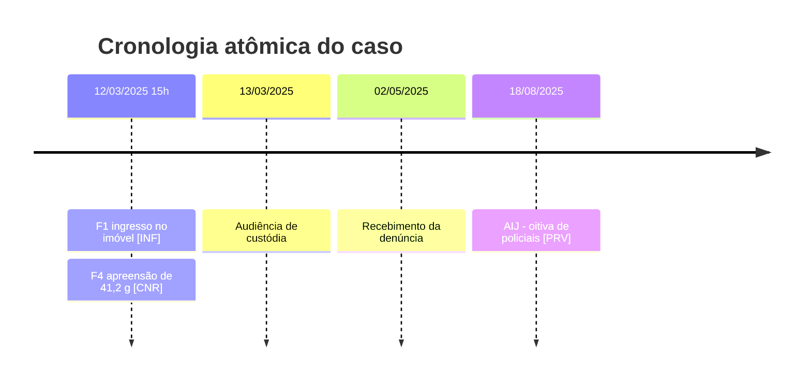
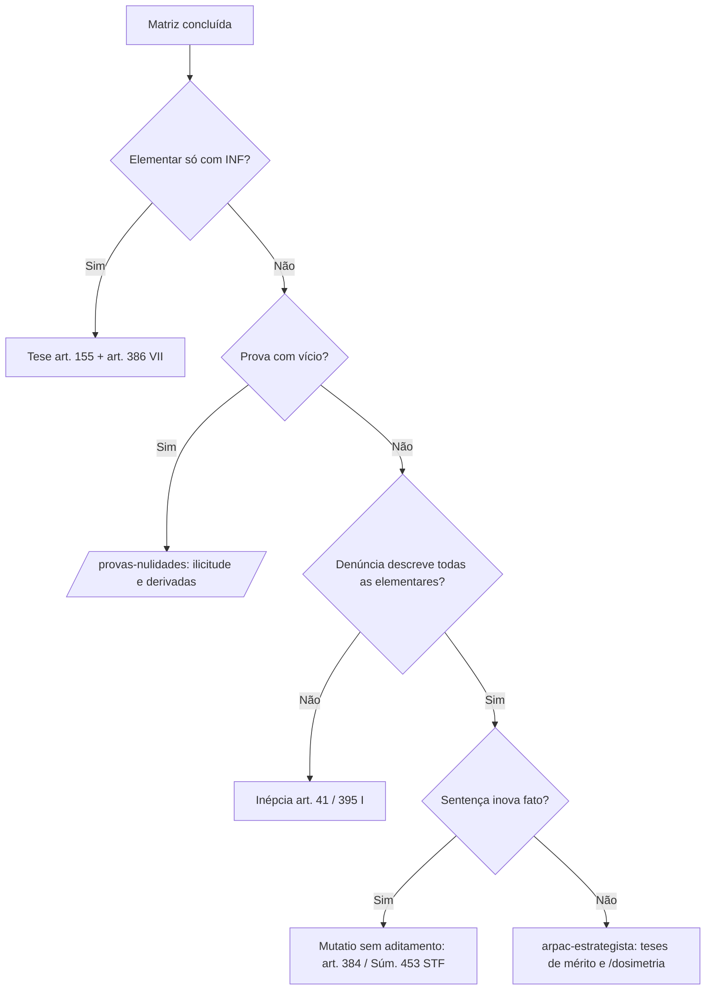

# 🔬 Habilidade: Decomposição Atômica Penal e Matriz Processual Penal de Provas (/decomposicao-penal)

Manual analítico profundo do ARPA-C para transformar a narrativa acusatória (denúncia, APF, relatório policial, sentença) em **proposições fáticas mínimas, verificáveis e rastreáveis**, testando cada uma contra o tipo penal, o ônus da acusação e a exigência de contraditório judicial. No crime, a pergunta nunca é "o que a defesa consegue provar", mas **"o que a acusação efetivamente provou, em juízo, para cada elementar"**.

---

## ⚡ Gatilho e Ativação
* **Comando**: `/decomposicao-penal`
* **Descrição**: Decompor fatos imputados e provados, gerar a Matriz Processual Penal de Provas, testar inépcia, justa causa, correlação e individualização das condutas, e gravar a base factual do caso na wiki.
* **Modo de Operação**: Auditor factual garantista. Despe a narrativa de adjetivos ("conhecido traficante", "frieza", "periculosidade"), separa conclusão jurídica de fato e recusa qualquer fato sem fonte (id/fl.). Toda lacuna vira `[PENDENTE: ...]` e pergunta socrática ao Douglas.
* **Não confundir**: `/decomposicao` (cível) trabalha com o art. 373 do CPC. Aqui o ônus é regido pela presunção de inocência (CF, art. 5º, LVII), pelo art. 156 do CPP e pela regra de julgamento do art. 386, VI e VII, do CPP.

---

## 🧠 1. O Fato Atômico Penal
Fato atômico é a declaração de **frase única**, **objetiva** (sem adjetivo, motivação presumida ou qualificação jurídica) e **verificável** (confirmável por documento, perícia, testemunho ou registro), acompanhada de **fonte** e **confiança**.

*Exemplo inadequado (denúncia típica)*: *"O denunciado, conhecido traficante da região, de forma fria, guardava grande quantidade de drogas em sua residência para vender a usuários, sendo preso após denúncia anônima."*

*Exemplo adequado (decomposição)*:
1. [F1] Em 12/03/2025, por volta das 15h, policiais militares ingressaram no imóvel da Rua [PENDENTE], Timbaúba/PE. `[INF]` (APF, id [PENDENTE], fl. 3 — MÉDIA)
2. [F2] O ingresso ocorreu sem mandado judicial. `[INF]` (APF, fl. 3 — MÉDIA) → vício potencial, remeter a `/provas-nulidades`.
3. [F3] A diligência foi motivada exclusivamente por notícia anônima recebida via 190. `[INF]` (BO, fl. 5 — MÉDIA)
4. [F4] Foram apreendidas 37 porções de substância esbranquiçada, massa líquida total de 41,2 g. `[CNR]` (auto de apreensão e laudo definitivo, fls. 9 e 41 — ALTA)
5. [F5] O laudo definitivo identificou a substância como cocaína. `[CNR]` (fl. 41 — ALTA)
6. [F6] Em sede policial, o conduzido declarou ser usuário. `[INF]` (termo de interrogatório, fl. 6 — MÉDIA)

Foram descartados "conhecido traficante" (rótulo sem fato), "fria" (adjetivo) e "para vender" — a finalidade de mercancia é **elementar subjetiva** que a acusação precisa provar com fatos próprios, à luz dos critérios do art. 28, § 2º, da Lei 11.343/06 (natureza e quantidade, local e condições da ação, circunstâncias sociais e pessoais, conduta e antecedentes).

---

## 🧱 2. As Camadas do Fato: Imputado × Informativo × Provado
| Código | Camada | Origem | Valor jurídico | Regra de uso |
| :--- | :--- | :--- | :--- | :--- |
| `[IMP]` | Fato imputado | Denúncia/queixa (e aditamento) | Delimita o objeto do processo | Base dos testes de inépcia (art. 41) e correlação (arts. 383/384) |
| `[INF]` | Elemento informativo | IP, APF, PIC, relatório policial | Sem contraditório; serve à justa causa (art. 395, III) e às cautelares | **Não sustenta condenação isoladamente** (art. 155 CPP) |
| `[CNR]` | Prova cautelar, não repetível ou antecipada | Interceptação, laudo de vestígio perecível, depoimento antecipado (arts. 225 e 366 CPP) | Ressalva expressa do art. 155 | Exige contraditório diferido e regularidade formal (cadeia de custódia, arts. 158-A a 158-F) |
| `[PRV]` | Prova judicial | Instrução em juízo | Base legítima do convencimento | Verificar oralidade, compromisso e possibilidade de reperguntas |
| `[DEF]` | Fato defensivo | Resposta à acusação, testemunhas, documentos da defesa | Álibi, excludentes, versão do réu | Basta gerar **fundada dúvida** (art. 386, VI, CPP) |

**Regra de ouro (art. 155 CPP)**: o juiz forma sua convicção pela prova produzida em contraditório judicial, não podendo fundamentar a decisão exclusivamente nos elementos informativos da investigação, ressalvadas as provas cautelares, não repetíveis e antecipadas. Logo, toda elementar `[IMP]` precisa estar ligada a ao menos um `[PRV]` ou `[CNR]` regular. Elementar sustentada só por `[INF]` = **lacuna probatória** → tese de absolvição (art. 386, II, V ou VII) ou de decote da circunstância.

Alertas de camada: (i) confissão extrajudicial retratada em juízo vale como `[INF]` e deve ser confrontada com as demais provas (art. 197 CPP); (ii) reconhecimento fotográfico ou pessoal na delegacia sem o rito do art. 226 é `[INF]` frágil e contaminante (STJ, HC 598.886/SC); (iii) depoimento policial que apenas reproduz o que "ouviu dizer" exige corroboração `[REQUER CONSULTA AO SISTEMA DE PRECEDENTES]`; (iv) pronúncia fundada só em `[INF]` é tema controvertido nos Tribunais `[REQUER CONSULTA AO SISTEMA DE PRECEDENTES]`.

---

## ✂️ 3. Decomposição da Denúncia por Elementar do Tipo (inépcia e correlação)
1. **Capitulação**: identificar o tipo e listar as **elementares objetivas** (verbo nuclear, objeto material, sujeito passivo, meio, elementos normativos), as **subjetivas** (dolo, especial fim de agir) e as **circunstâncias** imputadas (qualificadoras, majorantes, agravantes).
2. **Localização**: para cada item, transcrever o trecho da denúncia e a folha; classificar como *Descrito*, *Implícito* ou *Ausente*.
3. **Teste de inépcia** (art. 41 CPP: exposição do fato criminoso com todas as suas circunstâncias): elementar ou circunstância *Ausente* ou meramente repetida da letra da lei, sem fato concreto, gera rejeição (art. 395, I) ou nulidade. Arguir já na resposta à acusação (art. 396-A), pois há risco de a tese ser tida por superada após a sentença `[REQUER CONSULTA AO SISTEMA DE PRECEDENTES]`.
4. **Teste de correlação**: confrontar `[IMP]` com o fato reconhecido na sentença. Mesma descrição com nova capitulação = *emendatio* (art. 383, admissível). Elemento ou circunstância nova = *mutatio* (art. 384, exige aditamento, nova oitiva e interrogatório); vedada em segunda instância (STF, Súmula 453). Integração com `/recursos-penais`.

| Elementar / circunstância | Trecho da denúncia (fl.) | Status | Fato(s) atômico(s) | Consequência defensiva |
| :--- | :--- | :--- | :--- | :--- |
| "Subtrair coisa alheia móvel" (art. 157) | "subtraiu o aparelho celular da vítima" (fl. 2) | Descrito | F2 | Testar prova da subtração e do objeto |
| Grave ameaça | "mediante grave ameaça" (fl. 2) | Ausente (só fórmula legal) | — | Inépcia parcial ou desclassificação para furto (art. 155) |
| Emprego de arma de fogo (§ 2º-A, I) | "portando arma" (fl. 2) | Implícito | F3 | Exigir prova da arma; atacar majorante |
| Concurso de pessoas (§ 2º, II) | "em unidade de desígnios com terceiro não identificado" (fl. 2) | Descrito sem conduta do terceiro | F4 | Exigir prova do liame e da pluralidade |

---

## 🏛️ 4. Decomposição por Estrato da Teoria do Crime
| Estrato | Perguntas atômicas | Base legal | Tese típica de defesa |
| :--- | :--- | :--- | :--- |
| Existência do fato e autoria | O fato ocorreu? Quem praticou? Há prova judicial da autoria? | CPP, art. 386, I, II, IV e V | Negativa de autoria; insuficiência probatória |
| Materialidade | Houve vestígio? Há exame de corpo de delito? | CPP, arts. 158 e 167 | Falta de corpo de delito não suprível pela confissão |
| Tipicidade objetiva | Conduta, resultado, nexo causal, objeto material, insignificância | CP, art. 13 | Atipicidade; ausência de nexo; insignificância |
| Tipicidade subjetiva | Dolo ou culpa provados por fatos? Especial fim? Erro? | CP, arts. 18 e 20 | Erro de tipo; ausência de dolo; desclassificação |
| Iter criminis | Consumou-se? Houve desistência ou meio absolutamente ineficaz? | CP, arts. 14, 15 e 17 | Tentativa; desistência voluntária; crime impossível |
| Ilicitude | Há fato que indique excludente? | CP, arts. 23 a 25 | Legítima defesa; estado de necessidade |
| Culpabilidade | Imputabilidade, consciência da ilicitude, exigibilidade | CP, arts. 21, 22, 26 e 28 | Erro de proibição; coação moral irresistível; inimputabilidade |
| Punibilidade | Prescrição, decadência, causa extintiva? | CP, art. 107 | Remeter a `/prescricao` |
| Concurso de pessoas | Conduta de cada um, liame subjetivo, relevância causal | CP, arts. 29 e 30 | Participação de menor importância; cooperação dolosamente distinta |
| Fatos de dosimetria | Fatos concretos das circunstâncias do art. 59 e das majorantes | CP, arts. 59 e 68 | Remeter a `/dosimetria` |

---

## 📐 5. Matriz Processual Penal de Provas
| ID | Enunciado fático | Elementar/circunstância | Ônus | Prova existente / tipo / fonte | Contraditório? (art. 155) | Força | Vício / risco de ilicitude | Ação tática |
| :--- | :--- | :--- | :--- | :--- | :--- | :--- | :--- | :--- |
| **F3** | O agente exibiu objeto semelhante a arma de fogo ao abordar a vítima. | Grave ameaça; majorante § 2º-A, I | Acusação | Depoimento da vítima em juízo (mídia id [PENDENTE]) — testemunhal | Sim | **Frágil** (arma não apreendida nem periciada; descrição vaga) | — | Impugnar a majorante; sobre a dispensabilidade da apreensão `[REQUER CONSULTA AO SISTEMA DE PRECEDENTES]` |
| **F5** | A vítima reconheceu o réu por fotografia na delegacia. | Autoria | Acusação | Auto de reconhecimento (IP, fl. 12) — `[INF]` | Não | **Frágil** | Art. 226 CPP; STJ, HC 598.886/SC → `/provas-nulidades` | Arguir inidoneidade e contaminação do reconhecimento judicial posterior |
| **F7** | O réu participava de culto religioso no horário do fato. | Álibi `[DEF]` | Defesa, com standard reduzido (basta dúvida razoável) | Duas testemunhas e lista de presença [PENDENTE] | A produzir | — | — | Arrolar na resposta à acusação (art. 396-A) e juntar documento |
| **F8** | O celular foi apreendido em poder do réu 40 minutos após o fato. | Autoria (indício, art. 239) | Acusação | Auto de apreensão (APF, fl. 7) + depoimento policial em juízo | Parcial | **Frágil** (indício isolado; busca pessoal sem fundada suspeita?) | Art. 244 CPP → `/provas-nulidades` | Explorar a versão de aquisição lícita e a fragilidade do indício isolado |

**Legenda obrigatória**:
* **Ônus**: incumbe à **acusação** provar existência do fato, autoria, dolo, todas as elementares, qualificadoras, majorantes e agravantes (CF, art. 5º, LVII; CPP, art. 156, lido à luz da presunção de inocência). À **defesa** cabe apenas suscitar álibi ou excludente, bastando a **fundada dúvida** para absolver (CPP, art. 386, VI). O standard "além da dúvida razoável" é construção doutrinária e jurisprudencial, não texto de lei.
* **Força**: *Sólida* (prova judicial ou `[CNR]` regular, convergência de duas ou mais fontes independentes, perícia com cadeia de custódia íntegra); *Frágil* (apenas `[INF]`, palavra isolada, testemunho indireto, reconhecimento sem art. 226, indício único); *Inexistente* (afirmação sem lastro nos autos).
* **Vício**: sinalizar busca pessoal ou domiciliar, interceptação (Lei 9.296/96), extração de dados de celular, quebra de cadeia de custódia, confissão informal, e remeter **sempre** a `/provas-nulidades` (art. 157 CPP e teoria dos frutos da árvore envenenada, § 1º).

---

## 👥 6. Matriz de Individualização por Réu (concurso de agentes)
| Réu | Conduta individual descrita (verbo + ato concreto) | Fl. da denúncia | Liame subjetivo descrito? | Prova judicial da conduta individual | Diagnóstico |
| :--- | :--- | :--- | :--- | :--- | :--- |
| R1 | "Abordou a vítima e exigiu o celular" | fl. 2 | Sim | Vítima em juízo | Individualizada |
| R2 | "Concorreu de qualquer modo para o crime" | fl. 2 | Não | Nenhuma | **Denúncia genérica** → inépcia (art. 41) ou absolvição (art. 386, V) |
| R3 | "Aguardava na motocicleta" | fl. 3 | Implícito | Testemunha de ouvir dizer | Participação de menor importância (CP, art. 29, § 1º) ou cooperação dolosamente distinta (art. 29, § 2º) |

Regras: cada réu responde "na medida de sua culpabilidade" (CP, art. 29); circunstâncias pessoais só se comunicam quando elementares (CP, art. 30). Em crimes societários, distinguir denúncia **genérica** (inepta) de denúncia **geral** (aceita por parte da jurisprudência quando descreve o vínculo de cada um com o fato) `[REQUER CONSULTA AO SISTEMA DE PRECEDENTES]`. Tese favorável a um corréu, não exclusivamente pessoal, aproveita aos demais em recurso (CPP, art. 580).

---

## 🗂️ 7. Integração ARPA-C (arquivos e agentes)
* **Agente executor**: `arpac-auditor-autos` (M1, em paralelo com `arpac-prazos-prescricao`). Lê `raw/` (imutável) e `wiki/ficha.md`; escreve `wiki/fatos-atomicos.md` e `analise/02-decomposicao.md` (e as datas que alimentam `wiki/cronologia.md`).
* **Consumidores**: `arpac-prazos-prescricao` (datas-marco da cronologia), `arpac-estrategista` (árvore de teses em `analise/04-teses.md`), `arpac-revisor` (CoVe: toda afirmação fática da minuta deve apontar um ID F#), `arpac-redator` (narrativa dos fatos sem bullets, SPEC §7).
* **Fonte**: `(fonte: id <nº PJe>, fl. <x> — <confiança>)` (SCHEMA §5); nas tabelas, coluna "Fonte (id/fl.)" com o arquivo de `raw/`. **Confiança**: ALTA (2+ fontes ou documento oficial), MÉDIA (1 fonte), BAIXA/INFERIDO (exige validação humana no Portão 1).
* **Formato**: os esqueletos de `caso-modelo/` (e do agente `arpac-auditor-autos`) prevalecem; abaixo, os mesmos títulos e colunas, com frontmatter comum do SCHEMA §4.

**Modelo de `wiki/fatos-atomicos.md`**:
```markdown
# Fatos Atômicos e Matriz Processual Penal de Provas — <CASO>
## 1 Fatos Atômicos
| ID | Data/hora | Enunciado | Camada ([IMP] / [INF] / [CNR] / [PRV] / [DEF]) | Fonte (id/fl.) | Confiança | Liga-se a |
|---|---|---|---|---|---|---|
| F1 | 12/03/2025 15h | Policiais ingressaram no imóvel X | [INF] | raw/2025-03-12_apf_id123.md, id 123, fl. 3 | MÉDIA | Materialidade; vício domiciliar |
## 2 Matriz Processual Penal de Provas
| ID | Enunciado fático | Elementar/circunstância | Ônus | Prova existente / tipo / fonte | Contraditório? (art. 155) | Força | Vício / risco de ilicitude | Ação tática |
|---|---|---|---|---|---|---|---|---|
## 3 Fatos Controvertidos e Incontroversos
| ID | Situação (CONTROVERTIDO / INCONTROVERSO) | Versão da acusação | Versão da defesa | Observação |
|---|---|---|---|---|
## 4 Contradições entre Fontes
| Contradição | Fonte A (id/fl.) | Fonte B (id/fl.) | Relevância para a defesa |
|---|---|---|---|
| [CONTRADIÇÃO: F6 × F11] versão policial × versão judicial | APF, fl. 3 | mídia id 456 | [PENDENTE: avaliar] |
```
**Modelo de `analise/02-decomposicao.md`** (numeração idêntica à de `caso-modelo/analise/02-decomposicao.md`): §1 Síntese da Imputação; §2 Teoria do Crime Estratificada — 2.1 Fato típico, 2.2 Ilicitude, 2.3 Culpabilidade, 2.4 Punibilidade, 2.5 Autoria, participação e individualização por réu (a Matriz de Individualização da seção 6 desta skill), 2.6 Qualificadoras, majorantes e agravantes imputadas; §3 Pressupostos Processuais e Condições da Ação Penal; §4 Aptidão da Denúncia (arts. 41 e 395 CPP) — 4.1 Requisitos do art. 41 CPP, 4.2 Decomposição da denúncia por elementar (a tabela da seção 3 desta skill); §5 Correlação Acusação-Sentença (arts. 383 e 384 CPP); §6 Provas — Licitude, Nulidades e Lacunas — 6.1 Vícios (triagem para /provas-nulidades), 6.2 Elementares sustentadas só por [INF] (art. 155 CPP); §7 Divergências com a Ficha e Contradições Relevantes; §8 Fluxogramas — 8.1 Modelo visual dos fatos, 8.2 Próximos passos processuais; §9 Perguntas Socráticas (M1 — autos), `| Q# | Prioridade (CRÍTICA / ALTA / COMPLEMENTAR) | Pergunta | Por que importa | Onde encontrar | Bloqueia (módulo) |`. A Matriz Processual Penal de Provas (seção 5 desta skill) fica em `wiki/fatos-atomicos.md` §2; os alertas (RÉU PRESO, NULIDADE ABSOLUTA, DOCUMENTO ESSENCIAL AUSENTE) vão no frontmatter `alertas:` e no retorno do agente.

---

## 🗺️ 8. Modelo Visual (mermaid)



---

## ✅ 9. Checklist Obrigatório
- [ ] Cada fato tem frase única, sem adjetivo ou conclusão jurídica, com fonte (id/fl.) e confiança?
- [ ] Cada fato foi classificado em `[IMP]`, `[INF]`, `[CNR]`, `[PRV]` ou `[DEF]`?
- [ ] Toda elementar e circunstância imputada foi localizada na denúncia (Descrito / Implícito / Ausente)?
- [ ] Alguma elementar está sustentada **exclusivamente** por elemento do inquérito (art. 155 CPP)?
- [ ] As provas `[CNR]` respeitaram contraditório diferido e cadeia de custódia (arts. 158-A a 158-F)?
- [ ] O ônus foi atribuído à acusação em tudo, salvo álibi/excludente (standard de fundada dúvida, art. 386, VI)?
- [ ] Houve teste de correlação entre denúncia e sentença (arts. 383 e 384; Súmula 453 STF)?
- [ ] Em concurso de agentes, a conduta de cada réu está individualizada (art. 41; CP, art. 29)?
- [ ] Os vícios foram remetidos a `/provas-nulidades` e os fatos de pena a `/dosimetria`?
- [ ] As datas-marco (fato, recebimento, pronúncia, sentença) foram gravadas para `arpac-prazos-prescricao`?
- [ ] Todas as lacunas viraram `[PENDENTE: ...]` e perguntas socráticas para o Portão 1?

---

## ⚙️ Interface de Expansão (Notebooks Futuros)
> [!IMPORTANT]
> Placeholder para o script `decomposicao-penal.mjs`, que lerá os autos convertidos (`raw/*.md`, via Docling/OCR do pipeline `/automacao`), extrairá a denúncia e os termos de depoimento, proporá os fatos atômicos com id/fl., marcará automaticamente a camada (`[INF]` para peças anteriores ao recebimento da denúncia, `[PRV]` para termos de audiência) e pré-preencherá `wiki/fatos-atomicos.md` e a Matriz Processual Penal de Provas para validação humana. Futuro: detector de contradições entre depoimentos policiais e judiciais e exportação da linha do tempo para o Obsidian.
