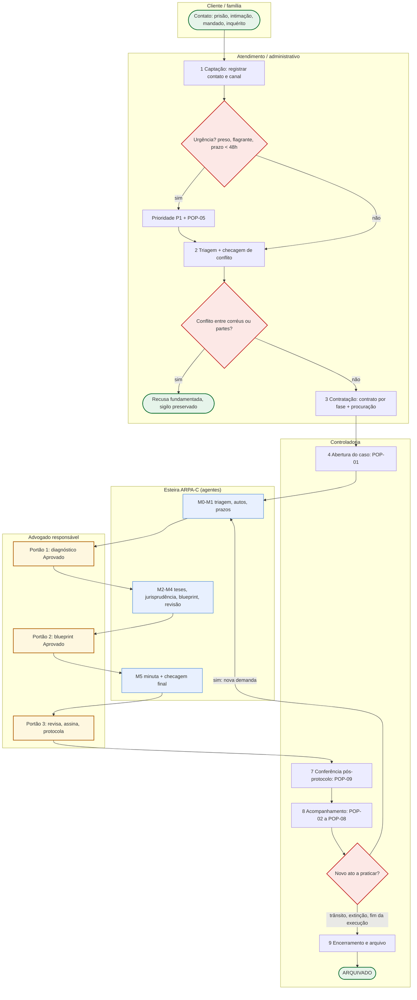

# 🗂️ Habilidade: Gestão de Processos Criminais (/gestao-processos)

Manual operacional que transforma a esteira ARPA-C (SPEC §4) em processo de trabalho mensurável: raias, POPs, SLAs, controladoria e um painel único de casos. Ativado pelo gatilho ou pelo agente `arpac-controller`. Formatos de arquivo alinhados ao `SCHEMA.md` do vault (§4, §7 e §8) e aos modelos de `caso-modelo/`.

> **Legenda** — 🔁 diretriz-base **substituível** pelo conteúdo do caderno **GESTÃO DE PROCESSOS** (ver 📓). 🔒 piso inegociável: nenhum caderno, pessoa ou agente o afasta.

## ⚡ Gatilho e Ativação
* **Comando**: `/gestao-processos` — Modo Gestão (SPEC §4) ou chamada do `arpac-controller` ao fim de cada portão.
* **Variações**: `painel` (painel semanal) · `abrir <caso>` (POP-01) · `prazos` (POP-02/03) · `pop <nº>` · `atualizar <caso>` (rotina do controller).
* **Modo de Operação**: o assistente atua como **Controller Jurídico (Legal Ops) do escritório criminal**. Não redige peças nem decide estratégia: garante que nada entre, ande ou saia da esteira sem dono, prazo, fonte e registro.

## 🔒 Piso inegociável
1. A IA nunca assina nem protocola; o Portão 3 é sempre do advogado responsável.
2. Todo prazo tem dupla conferência e a segunda é **humana** (POP-03). Prazo penal é calculado por `/prazos-penais`, nunca por `/prazos` (cível).
3. `#reu-preso` fura a fila: prioridade P1 e diagnóstico em até 24h.
4. Todo registro leva fonte (fl./id) e confiança (ALTA/MÉDIA/BAIXA), conforme SPEC §3.

## 🧭 Macroprocesso criminal do escritório (BPMN em raias) 🔁

Na urgência, o Douglas pode autorizar o primeiro ato (visita, custódia, HC) antes do contrato assinado, com regularização em até 48h.

## 📋 Kanban de casos (SPEC §5 e SCHEMA §8)
**Um card por caso.** Demandas simultâneas (ex.: HC e resposta à acusação) aparecem no card pela mais urgente, com `+N`, e todas ficam em `status.md` §3.

| Coluna | Entra quando | Definição de pronto para sair | WIP 🔁 |
|---|---|---|---|
| `ENTRADA` | caso registrado sem triagem (POP-01) | M0 concluído | — |
| `TRIAGEM` | fim do M0 (card criado ou movido pelo `arpac-triagem`) | `02` e `03` gravados; diagnóstico e perguntas apresentados | 4 |
| `DIAGNÓSTICO (aguarda Douglas)` | fim do M1 | "Aprovado" no Portão 1 | 5 |
| `ESTRATÉGIA` | Portão 1 aprovado | `04` a `07` gravados + "Aprovado" no Portão 2 | 3 |
| `REDAÇÃO` | Portão 2 aprovado | minuta gravada | 2 por advogado |
| `REVISÃO` | minuta gravada | veredito APROVADO do revisor (ou ajustes aplicados) | 3 |
| `PRONTO P/ PROTOCOLO` | veredito APROVADO | Douglas informa o protocolo (data e número) | ≤ 1 dia útil parado |
| `PROTOCOLADO / ACOMPANHAMENTO` | protocolo informado | encerramento, ou nova demanda (volta a `TRIAGEM`) | — |
| `ARQUIVADO` | encerramento (card `[x]`) | — | — |

**Prioridade** (campo `prioridade` do `status.md`, calculada pelo `arpac-controller` a partir dos alertas do SCHEMA §7) e classe de serviço correspondente 🔁: **P1 Expedite** = RÉU PRESO, PRAZO FATAL, REVISÃO 90 DIAS ou PRESCRIÇÃO IMINENTE (ignora WIP; no máximo 2 por advogado em produção simultânea, acima disso o Douglas redistribui ou aciona parceiro de plantão) · **P2 Data fixa** = PRAZO CURTO · **P3 Padrão** = demais. SLA-base das próximas ações: P1 no mesmo dia, P2 em até 48h, P3 em até 5 dias.

**Etiquetas** (critérios do SCHEMA §7): `#reu-preso` (preso ou internado em qualquer modalidade; também REVISÃO 90 DIAS e EXCESSO DE PRAZO) · `#prazo-fatal` (termo final em até 48h ou vencido; até 5 dias é o alerta PRAZO CURTO, sem etiqueta) · `#prescricao-risco` (consumação em até 180 dias ou já consumada) · `#juri` · `#maria-da-penha` (qualquer polo) · `#execucao` · `#superiores`.

**Regras de WIP** 🔁: (1) coluna no limite não recebe card novo: pare de começar, comece a terminar; (2) `DIAGNÓSTICO` acima do limite = gargalo no titular, e o controller leva à daily a fila ordenada por prazo interno; (3) card parado há mais de 5 dias na mesma coluna (exceto as duas últimas) é "envelhecido"; (4) veredito REPROVADO conta como retrabalho.

## ⏱️ SLAs internos 🔁
| Evento | SLA | Medição |
|---|---|---|
| Contato de familiar de preso / flagrante | retorno em até 2h (plantão: escala da equipe) | hora do contato → hora do retorno |
| Réu preso: diagnóstico preliminar (Portão 1) | **até 24h** da abertura | `status.md` §6 e §7 |
| Réu preso: primeira entrevista pessoal | até 48h do contrato; depois, no mínimo mensal | `log.md` |
| Réu solto: diagnóstico | 5 dias úteis ou D-5 do prazo fatal, o que vier antes | `status.md` §6 |
| Peça com prazo | em `PRONTO P/ PROTOCOLO` até o prazo interno (D-2), nunca com menos de 24h de folga para a revisão humana | `status.md` §3 |
| Leitura de intimações | diária até 10h; destino de todas até 12h | `log.md` |
| Protocolo → conferência | mesmo dia | POP-09 |
| Revisão nonagesimal da preventiva (CPP, art. 316, p.ú.) | alerta REVISÃO 90 DIAS 10 dias antes do limite | `wiki/prazos.md` §2 |
| Benefício na execução (SEEU) | alerta 30 dias antes da data prevista | `status.md` §2 |
| Retorno ao cliente / relatório simples | 1 dia útil / mensal e a cada ato relevante | `/gestao-escritorio` |

## 📑 POPs — Procedimentos Operacionais Padrão 🔁
Formato: **Gatilho** · **R** (executa) · **A** (responde) · **SLA**. Papéis em `/gestao-pessoas`. Nomes de arquivo em `raw/` seguem o SCHEMA §3 (`raw/AAAA-MM-DD_<tipo>_<id-ou-fl>.<ext>`).

**POP-01 — Abertura de caso.** Gatilho: contrato e procuração assinados ou urgência autorizada · R Assistente · A Controller · SLA mesmo dia (preso: 2h).
1. Confirmar que a checagem de conflito do intake foi feita (`/gestao-escritorio`); o `arpac-triagem` a registra em `analise/01-triagem.md` §5.
2. Copiar `caso-modelo/` para `casos/<CNJ-ou-apelido>/`; apelido sem nome de pessoa (ex.: `apf-trafico-2026-03`).
3. Depositar os autos em `raw/autos-integrais_AAAA-MM-DD.pdf` (download pela `/automacao`); `raw/` só é acrescido, nunca editado.
4. Criar o card em `ENTRADA` e acionar `/arpa-criminal` no modo cabível (completo, urgente ou revisão).

**POP-02 — Leitura diária de intimações e DJe.** Gatilho: todo dia útil · R Controller · A Advogado responsável · SLA 10h/12h.
1. Varrer todos os canais: painéis do PJe (TJPE, TRF5 e outros), SEEU, eproc se houver, Diário de Justiça Eletrônico e DJEN `[VERIFICAR canal oficial vigente por tribunal]`, e-mail e sistemas de push.
2. Atenção à ciência tácita da intimação eletrônica não consultada em 10 dias corridos (Lei 11.419/2006, art. 5º, §3º).
3. Para cada intimação: identificar caso, ato e data de disponibilização ou ciência; depositar a intimação em `raw/` e pedir ao orquestrador o reacionamento do `arpac-prazos-prescricao`.
4. Regra do dia zerado: nenhuma intimação termina o dia sem caso, prazo e responsável; resumo em `log.md`.

**POP-03 — Controle de prazos com dupla checagem.** Gatilho: todo prazo novo · R `arpac-prazos-prescricao` (CONF-1) e advogado humano (CONF-2) · A Advogado responsável.
1. **Prazo fatal** = termo final legal calculado por `/prazos-penais` em `wiki/prazos.md` (art. 798 CPP, Súmulas 310 e 710 STF, art. 798-A, regimes especiais), com fonte e fundamento. **Prazo interno** = fatal menos 2 dias úteis do escritório (D-2), lançado em `status.md` §3.
2. CONF-2 por **advogado humano que não calculou, em cálculo cego** (sem ver o primeiro). Divergência: vale o prazo mais curto e o Douglas decide.
3. Registro em `status.md` §2: coluna "Alerta" com `CONF-1`, depois `CONF-2 OK` ou `DIVERGÊNCIA`; coluna "Responsável" com as iniciais de quem fez a CONF-2; linha correspondente no `log.md`.
4. Alertas em D-5 (PRAZO CURTO), D-2, D-1 e na manhã do D0; peça sem minuta no D-1 entra no Modo Urgente. Baixa só com comprovante conferido (POP-09).

**POP-04 — Atendimento a cliente preso.** Gatilho: contrato, ato relevante ou rotina mensal · R Advogado · A Advogado responsável · SLA 48h / mensal.
1. Agendar visita segundo as regras da unidade `[VERIFICAR regulamento da unidade prisional]`; levar procuração, perguntas socráticas do Portão 1 e documentos a mostrar. Nunca portar objetos, cartas ou recados não autorizados (cf. CP, art. 349-A, sobre aparelhos de comunicação).
2. Entrevista pessoal e reservada é prerrogativa (Estatuto da OAB, art. 7º, III); violação da reserva → registrar e acionar a Comissão de Prerrogativas da OAB/PE.
3. Roteiro: integridade física (indício de tortura ou maus-tratos → registrar e requerer providências), versão dos fatos sem indução, provas e testemunhas favoráveis, condições pessoais úteis a cautelares e domiciliar (CPP, arts. 318 e 319), o que pode ser contado à família.
4. Salvar a nota como `raw/AAAA-MM-DD_atendimento_visita.md` e pedir INGEST. Família: só o autorizado pelo cliente, por um contato único; nunca discutir mérito por telefone com o preso.

**POP-05 — Audiência de custódia em plantão.** Gatilho: notícia de flagrante · R Plantonista · A Advogado responsável · SLA imediato.
1. Plantão com titular e backup (escala da equipe); celular de plantão separado do pessoal.
2. Localizar o autuado, confirmar a lavratura do APF e obter cópia (o auto vai ao juiz em até 24h — CPP, art. 306, §1º; audiência em até 24h da prisão — CPP, art. 310).
3. Coletar com a família comprovantes de residência, trabalho, filhos e saúde; entrevista prévia reservada com o autuado; orientá-lo a não discorrer sobre o mérito.
4. Acionar `/liberdade` (Modo Urgente): relaxamento, liberdade provisória com ou sem fiança, cautelares do art. 319, domiciliar do art. 318; na audiência, provocar o registro de eventual violência policial.
5. Pós-audiência: registrar a decisão, abrir o caso (POP-01), garantir o controle da revisão nonagesimal se houver preventiva e comunicar o familiar autorizado.

**POP-06 — Preparação de audiência de instrução.** Gatilho: designação · R Advogado · A Advogado responsável · SLA D-15.
1. D-15: reler `04-teses` e `06-blueprint`; conferir testemunhas arroladas na resposta à acusação (CPP, art. 396-A), intimação ou compromisso de comparecimento; link, se virtual.
2. D-7: roteiro de perguntas por testemunha a partir de `fatos-atomicos.md` e da Matriz de Provas (`/decomposicao-penal`); contradições com o inquérito; reconhecimento pessoal (`/provas-nulidades`).
3. D-3: preparar o cliente (interrogatório como último ato — CPP, art. 400; direito ao silêncio); requisição do réu preso; documentos a juntar.
4. Na audiência: consignar protestos e nulidades em ata no momento oportuno (CPP, art. 571). Depois: termo e mídia em `raw/` (INGEST) e prazo de diligências ou memoriais (CPP, arts. 402 e 403, §3º).

**POP-07 — Preparação de plenário do júri.** Gatilho: preclusão da pronúncia · R e A Advogado responsável · SLA conforme pauta.
1. Prazo crítico do art. 422 do CPP: 5 dias para rol de até 5 testemunhas, documentos e diligências.
2. Documentos e objetos a exibir em plenário: juntar com antecedência mínima de 3 dias úteis e ciência à parte contrária (CPP, art. 479).
3. Lista de jurados: análise ética (sem qualquer contato com jurados); plano de até 3 recusas peremptórias (CPP, art. 468).
4. Teses e quesitação com `/crimes-contra-vida` (CPP, art. 483): tese principal e subsidiárias compatíveis; ensaio cronometrado dos debates (CPP, art. 477).
5. Logística do réu preso (vestimenta civil; algemas só nas hipóteses da Súmula Vinculante 11); estagiário no controle de tempo e nas anotações. Pós-sessão: ata em `raw/` e prazo de apelação (`/recursos-penais`).

**POP-08 — Acompanhamento da execução penal (SEEU).** Gatilho: guia de execução · R Controller + Advogado · A Advogado responsável · SLA mensal.
1. Habilitação no SEEU; baixar atestado de pena e cálculo para `raw/` pela `/automacao`.
2. Auditar com `/execucao-penal` (data-base, frações, remição homologada, faltas e PAD) e lançar as datas previstas de benefícios em `status.md` §2.
3. Revisão mensal: novos atestados de trabalho ou estudo, decisões, incidentes; relatório simples ao apenado e à família autorizada.

**POP-09 — Protocolo e conferência pós-protocolo.** Gatilho: card em `PRONTO P/ PROTOCOLO` · R Douglas (protocolo) e Controller (conferência) · SLA mesmo dia.
1. Pré-protocolo (Douglas): peça e versão corretas, endereçamento, número do processo, tipo de documento no sistema, sigilo marcado quando cabível, anexos nomeados e em ordem, limite de tamanho `[VERIFICAR regras do tribunal]`.
2. Protocolo **humano**, com certificado digital do advogado responsável.
3. Pós-protocolo: a equipe deposita o comprovante como `raw/AAAA-MM-DD_comprovante-protocolo_<id>.pdf`; o controller confere se todos os anexos subiram e abrem e se a juntada consta dos autos, registra número e hora em `status.md` e `log.md`, dá baixa no prazo e move o card.

## 🧮 Controladoria jurídica — quem confere o quê 🔁
| Item | Executa | Confere | Evidência |
|---|---|---|---|
| Conflito de interesses | Assistente (intake) | `arpac-triagem` + Controller | `01-triagem.md` §5 |
| Leitura de intimações | Controller | Advogado (daily) | `log.md` do dia |
| Cálculo de prazo | `arpac-prazos-prescricao` (CONF-1) | Advogado humano, cego (CONF-2) | `status.md` §2 |
| Citações e jurisprudência | `arpac-pesquisador` | `arpac-revisor` (CoVe) + advogado | `05` e `07` |
| Anexos da peça | Estagiário | Advogado | checklist do POP-09 |
| Protocolo | Douglas | Controller (pós-protocolo) | comprovante em `raw/` |
| Kanban e status | `arpac-controller` | Douglas (reunião semanal) | card × `status.md` (LINT) |

## 🧾 Formatos
**`Shared/painel-casos.md`** — quadro do plugin Kanban do Obsidian (`kanban-plugin: basic`), com uma seção `## <COLUNA>` por coluna do SPEC §5 e um card de uma linha por caso:
```
- [ ] **<CASO>** | <peça ou objetivo> | prazo: <AAAA-MM-DD ou —> | resp: <iniciais> | atualizado: <AAAA-MM-DD> #etiquetas
```
`prazo` = termo final mais próximo (`prazo_mais_proximo` de `wiki/prazos.md`). Na coluna, `#reu-preso` e `#prazo-fatal` primeiro e depois o prazo mais próximo; `[x]` só em `ARQUIVADO`. O arquivo **não recebe tabelas**: o plugin regrava o quadro a cada movimento e descartaria o que não for card.

**Painel semanal** — produzido pelo `arpac-controller` no Modo Gestão (evento `painel-semanal`), entregue ao Douglas toda segunda-feira e pauta da reunião semanal (`/gestao-pessoas`). Só é gravado em `Shared/painel-semanal-AAAA-MM-DD.md` quando o orquestrador enviar `salvar: sim` a pedido do Douglas. Modelo (idêntico ao do agente):
```markdown
# Painel Semanal — <DD/MM/AAAA> a <DD/MM/AAAA>
## 1 Alertas Críticos
| Caso | Alerta | Data-limite | Responsável | Ação |
## 2 Casos por Coluna
| Coluna | Nº de casos | Casos |
## 3 Prazos dos Próximos 7 Dias
| Data | Caso | Ato | Responsável | Situação |
## 4 Carga da Equipe
| Iniciais | Casos ativos | Réus presos | Prazos em 7 dias | Ocupação | Observação |
## 5 KPIs
| Indicador | Valor | Meta | Tendência |
## 6 Gargalos e Recomendações
| Gargalo | Evidência | Recomendação |
```
Preenchimento: §1 traz todo réu preso com a próxima revisão do art. 316 e a última visita, além dos alertas do SCHEMA §7; §2 compara cada coluna com o limite de WIP; §3 usa em "Situação" o estado da conferência (`CONF-1`, `CONF-2 OK`, `DIVERGÊNCIA`); §5 recebe, na primeira semana do mês, os KPIs de `/gestao-escritorio`; §6 lista cards envelhecidos, WIP estourado e portões aguardando o Douglas. Casos por CNJ ou apelido; pessoas por iniciais.

**`casos/<caso>/gestao/status.md`** — modelo oficial em `caso-modelo/gestao/status.md`: frontmatter comum do SCHEMA §4 + `coluna_kanban`, `etapa`, `prioridade` (P1 | P2 | P3) e `responsavel_humano`; seções e cabeçalhos:
```
## 1 Situação Atual                 | Campo | Valor |
## 2 Prazos e Datas Críticas        | Data-limite | Evento | Alerta | Responsável |
## 3 Próximos Passos                | # | Ação | Responsável (R) | Aprovador (A) | Prazo interno (SLA) | Status |
## 4 Pendências Abertas             | # | Pendência ([PENDENTE]) | Origem (arquivo) | Quem resolve | Desde |
## 5 Esteira do Caso                | Etapa | Agente / responsável | Arquivo | Situação | Data |
## 6 Decisões e Respostas do Douglas nos Portões | Data | Portão | Decisão ou resposta (Q# respondidas) | Efeito na esteira |
## 7 Indicadores do Caso            | Indicador | Valor | Observação |
```
Preenchimento: §2 espelha `wiki/prazos.md` e guarda a dupla conferência (POP-03); §3 traz o prazo interno; §5 usa o vocabulário `vazio | rascunho | concluido | aprovado | superado`; §6 recebe o "Aprovado" textual; §7 mede dias desde a entrada, dias na coluna, versões de minuta, vereditos REPROVADO e pendências. **`gestao/log.md`** é só acrescido: `| Data e hora | Agente / pessoa | Módulo | Ação | Arquivos lidos | Arquivos gravados | Alertas | Portão |`; correção = nova linha `RETIFICA linha n`.

## 🔄 Rotina do `arpac-controller` ao fim de cada portão
| Momento | Card → | Atualizações específicas |
|---|---|---|
| Fim do M1 | `DIAGNÓSTICO (aguarda Douglas)` | §5 de M0/M1; §2 com prazos em `CONF-1`; §4 pendências; hora de início do Portão 1 (SLA de 24h do réu preso) |
| Portão 1 "Aprovado" | `ESTRATÉGIA` | §6 com as Q# respondidas; §7 tempo de resposta; pedido de CONF-2 dos prazos ainda em `CONF-1` |
| Portão 2 "Aprovado" | `REDAÇÃO` | §6; §3 com o prazo interno de entrega da minuta |
| Minuta gravada / veredito | `REVISÃO` → `PRONTO P/ PROTOCOLO` | REPROVADO mantém o card em `REVISÃO` e soma em §7 |
| Douglas informa "Protocolado" (data e número) | `PROTOCOLADO / ACOMPANHAMENTO` | POP-09; baixa do prazo; próximos prazos em §2 e §3 |

Em todos os momentos:
1. Verificar a existência e a data dos arquivos de saída do módulo (SPEC §3) e os alertas de `07-revisao.md`.
2. Atualizar o card (coluna, peça ou objetivo, prazo, resp, atualizado, etiquetas, posição) e o frontmatter do `status.md` (`coluna_kanban`, `etapa`, `prioridade`, `alertas`, `versao` + 1, `atualizado_em`).
3. Acrescentar a linha no `log.md`; checar WIP, envelhecimento e SLA; incidente (atraso, retrabalho, erro de prazo) → `napkin_log.md`.
4. Devolver ao orquestrador resumo de até 15 linhas com os alertas (RÉU PRESO, PRAZO FATAL, PRESCRIÇÃO IMINENTE). Nunca mover para `PROTOCOLADO` sem informação humana do protocolo.

## ✅ Checklist obrigatório
- [ ] Cada caso tem um único card, em coluna válida, com prazo, responsável e etiquetas corretos?
- [ ] Todo prazo em `status.md` §2 tem fonte, prazo interno e `CONF-2 OK` (humana)?
- [ ] Réus presos: diagnóstico em 24h, visita em dia e revisão nonagesimal controlada?
- [ ] Alguma coluna estourou o WIP ou há card envelhecido?
- [ ] A leitura de intimações do dia foi registrada e zerada?
- [ ] Cards em `PRONTO P/ PROTOCOLO` estão dentro do prazo interno?
- [ ] Todo protocolo tem comprovante conferido antes da baixa do prazo?
- [ ] Card, `status.md` e `log.md` estão coerentes entre si (LINT)?

## 🔗 Integração com o ARPA-C
* **`arpac-controller`**: aplica toda a skill; escreve `gestao/status.md`, `gestao/log.md`, o card em `Shared/painel-casos.md`, `napkin_log.md` e `memory.md`; produz o painel semanal e o LINT.
* **`arpac-triagem`**: define prioridade, etiquetas e responsável no M0 e cria o card em `TRIAGEM` (`01-triagem.md` §8).
* **Orquestrador `/arpa-criminal`**: chama o controller após cada portão e dispara o Modo Urgente quando a prioridade é P1.

## 📓 Integração NotebookLM — caderno GESTÃO DE PROCESSOS
Mecanismo do SPEC §6, nesta ordem:
1. Com MCP do NotebookLM na sessão (`mcp__notebooklm__*`), consultar o caderno com as perguntas abaixo e citar `[NotebookLM: Gestão de Processos]`.
2. Sem MCP, ler `Shared/conhecimento/processos.md`.
3. Sem nenhum dos dois, aplicar as diretrizes 🔁 desta skill e registrar `[SEM BASE NOTEBOOKLM — aplicar diretriz-base]` no `log.md`.

O conteúdo do caderno **substitui** as seções 🔁 quando divergir (ex.: WIP, SLAs, formato de POP), mas nunca o 🔒 piso inegociável. Perguntas-padrão (iguais às de `notebooklm/cadernos.md`):
- **PROC-01** Quais etapas as fontes recomendam para mapear o macroprocesso de um escritório de advocacia, do primeiro contato ao arquivamento, e que notação (BPMN, fluxograma) sugerem?
- **PROC-02** Como as fontes orientam a redação de um Procedimento Operacional Padrão (POP) jurídico: campos obrigatórios, nível de detalhe, revisão e versionamento?
- **PROC-03** Que método de controle de prazos as fontes recomendam (prazo fatal × prazo interno, dupla conferência, responsáveis) e quais falhas mais comuns apontam?
- **PROC-04** Como aplicar Kanban a um escritório de advocacia segundo as fontes: colunas, limites de WIP, prioridades/classes de serviço e cadência de revisão do quadro?
- **PROC-05** Quais SLAs internos ou tempos-padrão de resposta as fontes sugerem para atendimento, análise de caso e produção de peças, e como medi-los?
- **PROC-06** O que é controladoria jurídica (legal ops) segundo as fontes, quais atividades concentra e como se organiza em escritório de pequeno porte?
- **PROC-07** Quais indicadores de processo (lead time, retrabalho, gargalos, cumprimento de prazos) as fontes recomendam acompanhar e com que periodicidade?
- **PROC-08** Como as fontes recomendam conduzir a leitura diária de intimações/publicações e a conferência pós-protocolo?
- **PROC-09** Como aplicar o ciclo PDCA ou outra metodologia de melhoria contínua aos processos internos do escritório, segundo as fontes?
- **PROC-10** Que ferramentas ou rotinas de automação de processos (agenda, alertas, painéis) as fontes indicam para escritórios pequenos?

## ⚙️ Interface de Expansão
> [!IMPORTANT]
> Placeholders para scripts futuros: `painel.py` (gera o painel semanal a partir dos cards e dos `status.md` e valida colunas, etiquetas e coerência card × status), `alertas_prazos.py` (agenda os alertas D-5/D-2/D-1/D0 no calendário e avisa o próprio Douglas pelo WhatsApp) e `importar_intimacoes.py` (lê o push dos tribunais e deposita as intimações em `raw/` para reacionar o cálculo de prazos).
