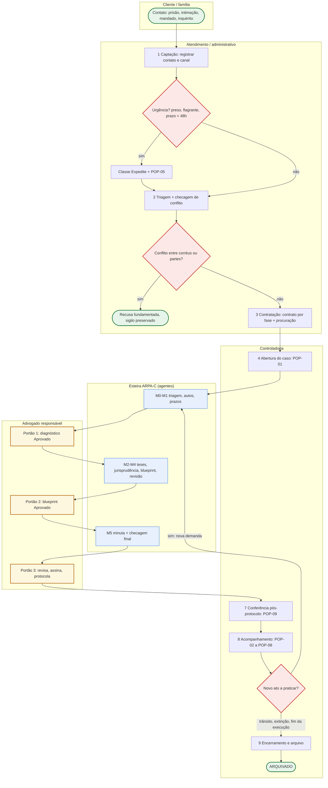

# 🗂️ Habilidade: Gestão de Processos Criminais (/gestao-processos)

Manual operacional que transforma a esteira ARPA-C (SPEC §4) em processo de trabalho mensurável: raias, POPs, SLAs, controladoria e um painel único de casos. Ativado pelo gatilho ou pelo agente `arpac-controller`.

> **Legenda** — 🔁 diretriz-base **substituível** pelo conteúdo do caderno **GESTÃO DE PROCESSOS** (ver 📓). 🔒 piso inegociável: nenhum caderno, pessoa ou agente o afasta.

## ⚡ Gatilho e Ativação
* **Comando**: `/gestao-processos` — Modo Gestão (SPEC §4) ou chamada do `arpac-controller` ao fim de cada portão.
* **Variações**: `painel` (painel semanal) · `abrir <caso>` (POP-01) · `prazos` (POP-02/03) · `pop <nº>` · `atualizar <caso>` (rotina do controller).
* **Modo de Operação**: o assistente atua como **Controller Jurídico (Legal Ops) do escritório criminal**. Não redige peças nem decide estratégia: garante que nada entre, ande ou saia da esteira sem dono, prazo, fonte e registro.

## 🔒 Piso inegociável
1. A IA nunca assina nem protocola; o Portão 3 é sempre do advogado responsável.
2. Todo prazo tem dupla conferência e a segunda é **humana** (POP-03). Prazo penal é calculado por `/prazos-penais`, nunca por `/prazos` (cível).
3. `#reu-preso` fura a fila: classe Expedite e diagnóstico em até 24h.
4. Todo registro leva fonte (fl./id) e confiança (ALTA/MÉDIA/BAIXA), conforme SPEC §3.

## 🧭 Macroprocesso criminal do escritório (BPMN em raias) 🔁

Na urgência, o Douglas pode autorizar o primeiro ato (visita, custódia, HC) antes do contrato assinado, com regularização em até 48h.

## 📋 Kanban de casos (colunas e etiquetas do SPEC §5)
**Cartão = demanda** (um ato ou peça), com ID `<caso>#D<n>`; um caso pode ter várias demandas ativas (ex.: HC e resposta à acusação).

| Coluna | Entra quando | Sai quando (definição de pronto) | Dono | WIP 🔁 |
|---|---|---|---|---|
| `ENTRADA` | contato registrado | conflito checado + contrato/procuração ou urgência autorizada | Assistente | — |
| `TRIAGEM` | POP-01 concluído | `01-triagem`, `02-decomposicao`, `03-prazos-prescricao` gravados | triagem/auditor/prazos | 4 |
| `DIAGNÓSTICO (aguarda Douglas)` | diagnóstico + perguntas socráticas entregues | "Aprovado" no Portão 1 | Douglas | 5 |
| `ESTRATÉGIA` | Portão 1 aprovado | `04` a `07` gravados + "Aprovado" no Portão 2 | estrategista/pesquisador/revisor | 3 |
| `REDAÇÃO` | Portão 2 aprovado | `minutas/<peca>-vN` gravada | redator + advogado | 2 por advogado |
| `REVISÃO` | minuta gravada | `07-revisao` (seção Minuta) sem bloqueio + leitura humana integral | revisor + advogado | 3 |
| `PRONTO P/ PROTOCOLO` | revisão concluída | protocolo pelo Douglas + comprovante | Douglas | ≤ 1 dia útil parado |
| `PROTOCOLADO / ACOMPANHAMENTO` | POP-09 concluído | nova demanda (volta a `TRIAGEM`) ou encerramento | Controller | — |
| `ARQUIVADO` | encerramento registrado | — | Controller | — |

**Classes de serviço** 🔁: **Expedite** = `#reu-preso` com pedido de liberdade, flagrante ou prazo < 48h (ignora WIP; máx. 2 por advogado, acima disso o Douglas redistribui ou aciona parceiro de plantão) · **Data fixa** = prazos peremptórios, audiências, plenário · **Padrão** = demais peças · **Intangível** = execução de longo prazo, LINT, capacitação.

**Etiquetas**: `#reu-preso` (custodiado por qualquer título) · `#prazo-fatal` (prazo fatal em ≤ 5 dias corridos 🔁) · `#prescricao-risco` (prescrição em ≤ 6 meses 🔁 ou possivelmente consumada, segundo `03-prazos-prescricao.md`) · `#juri` · `#maria-da-penha` (qualquer polo) · `#execucao` (SEEU) · `#superiores` (STJ/STF).

**Regras de WIP** 🔁: (1) coluna no limite não recebe cartão novo: pare de começar, comece a terminar; (2) `DIAGNÓSTICO` acima do limite = gargalo no titular, e o controller leva à daily a fila ordenada por prazo interno; (3) cartão parado > 3 dias úteis na mesma coluna (exceto as duas últimas) gera alerta de envelhecimento; (4) volta de `REVISÃO` para `REDAÇÃO` conta como retrabalho.

## ⏱️ SLAs internos 🔁
| Evento | SLA | Medição |
|---|---|---|
| Contato de familiar de preso / flagrante | retorno em até 2h (plantão: escala de `Shared/equipe.md`) | hora do contato → hora do retorno |
| Réu preso: diagnóstico preliminar (Portão 1) | **até 24h** da abertura | `status.md`, Portão 1 |
| Réu preso: primeira entrevista pessoal | até 48h do contrato; depois, no mínimo mensal | `log.md` |
| Réu solto: diagnóstico | 5 dias úteis ou D-5 do prazo fatal, o que vier antes | `status.md` |
| Peça com prazo | em `PRONTO P/ PROTOCOLO` até o prazo interno (D-2) | data de entrada na coluna |
| Leitura de intimações | diária até 10h; destino de todas até 12h | `log.md` do dia |
| Protocolo → conferência | mesmo dia | POP-09 |
| Revisão nonagesimal da preventiva (CPP, art. 316, p.ú.) | alerta no D-10 do 90º dia | tabela "Réus presos" |
| Benefício na execução (SEEU) | alerta no D-30 da data prevista | `status.md`, Prazos ativos |
| Retorno ao cliente / relatório simples | 1 dia útil / mensal e a cada ato relevante | `/gestao-escritorio` |

## 📑 POPs — Procedimentos Operacionais Padrão 🔁
Formato: **Gatilho** · **R** (executa) · **A** (responde) · **SLA**. Papéis detalhados em `/gestao-pessoas`.

**POP-01 — Abertura de caso.** Gatilho: contrato e procuração assinados ou urgência autorizada · R Assistente · A Controller · SLA mesmo dia (preso: 2h).
1. Registrar checagem de conflito (data, quem, nomes cruzados) conforme `/gestao-escritorio`.
2. Copiar `caso-modelo` para `casos/<CNJ-ou-apelido>/`; apelido sem nome do cliente (ex.: `2026-tbu-roubo-01`).
3. Ingerir autos em `raw/` pelo pipeline `/automacao` (download → Docling → mapa); `raw/` só é acrescido, nunca editado.
4. Criar `gestao/status.md` e `gestao/log.md` (formatos abaixo); inserir cartão em `TRIAGEM` com etiquetas e classe.
5. Lançar prazos já conhecidos com confiança BAIXA até a auditoria do M1; acionar `/arpa-criminal` no modo cabível.

**POP-02 — Leitura diária de intimações e DJe.** Gatilho: todo dia útil · R Controller · A Advogado responsável · SLA 10h/12h.
1. Varrer todos os canais: painéis do PJe (TJPE, TRF5 e outros), SEEU, eproc se houver, Diário de Justiça Eletrônico e DJEN `[VERIFICAR canal oficial vigente por tribunal]`, e-mail e sistemas de push.
2. Atenção à ciência tácita da intimação eletrônica não consultada em 10 dias corridos (Lei 11.419/2006, art. 5º, §3º).
3. Para cada intimação: identificar caso, ato e data de disponibilização/ciência; lançar em "Prazos ativos" do `status.md` como conferência 1.
4. Regra do dia zerado: nenhuma intimação termina o dia sem caso, prazo e responsável; registrar resumo em `log.md`.

**POP-03 — Controle de prazos com dupla checagem.** Gatilho: todo prazo novo · R Controller/`arpac-prazos-prescricao` · A Advogado responsável.
1. **Prazo fatal** = cálculo legal por `/prazos-penais` (art. 798 CPP, Súmulas 310 e 710 STF, art. 798-A, regimes especiais), com fonte e dispositivo. **Prazo interno** = fatal menos 2 dias úteis do escritório (D-2).
2. Conferência 1 (IA ou controller) e conferência 2 por **advogado humano, em cálculo cego** (sem ver o primeiro). Divergência: vale o prazo mais curto e o Douglas decide.
3. Alertas em D-5, D-2, D-1 e na manhã do D0. Peça sem minuta no D-1 entra automaticamente no Modo Urgente.
4. Baixa do prazo só com comprovante de protocolo conferido (POP-09).

**POP-04 — Atendimento a cliente preso.** Gatilho: contrato, ato relevante ou rotina mensal · R Advogado · A Advogado responsável · SLA 48h / mensal.
1. Agendar visita segundo as regras da unidade `[VERIFICAR regulamento da unidade prisional]`; levar procuração, perguntas socráticas do Portão 1 e documentos a mostrar. Nunca portar objetos, cartas ou recados não autorizados (cf. CP, art. 349-A, sobre aparelhos de comunicação).
2. Entrevista pessoal e reservada é prerrogativa (Estatuto da OAB, art. 7º, III); violação de reserva → registrar e acionar a Comissão de Prerrogativas da OAB/PE.
3. Roteiro: integridade física (indício de tortura/maus-tratos → registrar e requerer providências), versão dos fatos sem indução, provas e testemunhas favoráveis, condições pessoais úteis a cautelares e domiciliar (CPP, arts. 318 e 319), o que pode ser contado à família.
4. Salvar a nota em `raw/atendimentos/AAAA-MM-DD-visita.md` (arquivo novo) e acionar INGEST. Família: só o autorizado pelo cliente, por um contato único; nunca discutir mérito por telefone com o preso.

**POP-05 — Audiência de custódia em plantão.** Gatilho: notícia de flagrante · R Plantonista · A Advogado responsável · SLA imediato.
1. Plantão com titular e backup em `Shared/equipe.md`; celular de plantão separado do pessoal.
2. Localizar o autuado, confirmar lavratura do APF e obter cópia (o auto vai ao juiz em até 24h — CPP, art. 306, §1º; audiência em até 24h da prisão — CPP, art. 310).
3. Coletar com a família comprovantes de residência, trabalho, filhos e saúde; entrevista prévia reservada com o autuado; orientá-lo a não discorrer sobre o mérito.
4. Acionar `/liberdade` (Modo Urgente): relaxamento, liberdade provisória com ou sem fiança, cautelares do art. 319, domiciliar do art. 318; na audiência, provocar o registro de eventual violência policial.
5. Pós-audiência: registrar a decisão, abrir o caso (POP-01), lançar a revisão nonagesimal se houver preventiva e comunicar o familiar autorizado.

**POP-06 — Preparação de audiência de instrução.** Gatilho: designação · R Advogado · A Advogado responsável · SLA D-15.
1. D-15: reler `04-teses` e `06-blueprint`; conferir testemunhas arroladas na resposta à acusação (CPP, art. 396-A), intimação ou compromisso de comparecimento; link, se virtual.
2. D-7: roteiro de perguntas por testemunha a partir de `fatos-atomicos.md` e da Matriz de Provas (`/decomposicao-penal`); contradições com o inquérito; reconhecimento pessoal (`/provas-nulidades`).
3. D-3: preparar o cliente (interrogatório como último ato — CPP, art. 400; direito ao silêncio); requisição do réu preso; documentos a juntar.
4. Na audiência: consignar protestos e nulidades em ata no momento oportuno (CPP, art. 571). Depois: termo e mídia em `raw/` (INGEST) e prazo de diligências ou memoriais (CPP, arts. 402 e 403, §3º).

**POP-07 — Preparação de plenário do júri.** Gatilho: preclusão da pronúncia · R Advogado responsável · A Advogado responsável · SLA conforme pauta.
1. Prazo crítico do art. 422 do CPP: 5 dias para rol de até 5 testemunhas, documentos e diligências (`#prazo-fatal`).
2. Documentos e objetos a exibir em plenário: juntar com antecedência mínima de 3 dias úteis e ciência à parte contrária (CPP, art. 479).
3. Lista de jurados: análise ética (sem qualquer contato com jurados); plano de até 3 recusas peremptórias (CPP, art. 468).
4. Teses e quesitação com `/crimes-contra-vida` (CPP, art. 483): tese principal e subsidiárias compatíveis; ensaio cronometrado dos debates (CPP, art. 477).
5. Logística do réu preso (vestimenta civil; uso de algemas só nas hipóteses da Súmula Vinculante 11); apoio de estagiário no controle de tempo e anotações. Pós-sessão: ata em `raw/` e prazo de apelação (`/recursos-penais`).

**POP-08 — Acompanhamento da execução penal (SEEU).** Gatilho: guia de execução · R Controller + Advogado · A Advogado responsável · SLA mensal.
1. Habilitação no SEEU; baixar atestado de pena e cálculo para `raw/` via `/automacao`.
2. Auditar com `/execucao-penal` (data-base, frações, remição homologada, faltas e PAD) e lançar as datas previstas de benefícios em "Prazos ativos" com alerta D-30.
3. Revisão mensal: novos atestados de trabalho/estudo, decisões, incidentes; relatório simples ao apenado e à família autorizada.

**POP-09 — Protocolo e conferência pós-protocolo.** Gatilho: cartão em `PRONTO P/ PROTOCOLO` · R Douglas (protocolo) e Controller (conferência) · SLA mesmo dia.
1. Pré-protocolo (Douglas): peça e versão corretas, endereçamento, número do processo, tipo de documento no sistema, sigilo marcado quando cabível, anexos nomeados e em ordem, limite de tamanho `[VERIFICAR regras do tribunal]`.
2. Protocolo **humano**, com certificado digital do advogado responsável.
3. Pós-protocolo (controller): salvar o comprovante em `raw/protocolos/`; conferir se todos os anexos subiram e abrem e se a juntada consta dos autos; registrar número e hora em `status.md` e `log.md`; dar baixa no prazo; mover o cartão.

## 🧮 Controladoria jurídica — quem confere o quê 🔁
| Item | Executa | Confere | Evidência |
|---|---|---|---|
| Conflito de interesses e cadastro | Assistente | Controller | registro em `wiki/ficha.md` |
| Leitura de intimações | Controller | Advogado (daily) | `log.md` do dia |
| Cálculo de prazo | `arpac-prazos-prescricao` / Controller | Advogado humano (cego) | "Prazos ativos" |
| Citações e jurisprudência | `arpac-pesquisador` | `arpac-revisor` (CoVe) + advogado | `05` e `07` |
| Anexos da peça | Estagiário | Advogado | checklist do POP-09 |
| Protocolo | Douglas | Controller (pós) | comprovante em `raw/protocolos/` |
| Painel e status | `arpac-controller` | Douglas (reunião semanal) | `Shared/painel-casos.md` |

## 📊 Painel semanal 🔁
Toda segunda-feira, no Modo Gestão, o `arpac-controller` reescreve a seção "Semana" do painel com: prazos da semana (D0 a D+7), audiências e plenários, réus presos (dias de prisão, próxima revisão, última visita), cartões envelhecidos, WIP por coluna, gargalos e pendências de portão. Uma vez por mês, acrescenta os KPIs definidos em `/gestao-escritorio`. Esse painel é a pauta da reunião semanal (`/gestao-pessoas`).

## 🧾 Formatos obrigatórios
**`Shared/painel-casos.md`** — a tabela "Quadro" é a fonte da verdade; as demais seções derivam dela.
```markdown
---
tipo: painel
atualizado_em: AAAA-MM-DD HH:MM
atualizado_por: arpac-controller
---
# Painel de Casos Criminais
## 🚨 Alertas ativos
| Nível | ID | Alerta | Data-limite | Responsável | Ação imediata |
|---|---|---|---|---|---|
## Quadro
| ID | Caso | Cliente | Polo | Coluna | Etiquetas | Classe | Demanda / próximo ato | Prazo fatal | Prazo interno | Responsável | Revisor | Na coluna desde | Atualizado em |
|---|---|---|---|---|---|---|---|---|---|---|---|---|---|
## WIP por coluna
| Coluna | Limite | Atual | Situação |
|---|---|---|---|
## Réus presos
| ID | Cliente | Unidade | Preso desde | Dias | Título da prisão | Última revisão (art. 316) | Próxima revisão | Última visita |
|---|---|---|---|---|---|---|---|---|
## Semana AAAA-Www
## 📊 Indicadores do mês
| KPI | Fórmula | Meta | Resultado | Tendência |
|---|---|---|---|---|
```
Valores permitidos: `Coluna` = exatamente uma das 9 colunas do SPEC §5; `Cliente` = iniciais; `Classe` = expedite | data-fixa | padrao | intangivel; `Nível` = CRÍTICO | ALTO | MÉDIO; datas `AAAA-MM-DD`.

**`casos/<caso>/gestao/status.md`**
```markdown
---
caso: <CNJ-ou-apelido>
cnj: NNNNNNN-DD.AAAA.J.TR.OOOO
cliente: <iniciais>
polo: defesa | assistencia-acusacao | querelante
coluna: TRIAGEM
etiquetas: []
classe: padrao
modo: completo | urgente | revisao | gestao
responsavel: <pessoa>
revisor: <pessoa>
atualizado_em: AAAA-MM-DD HH:MM
---
# Status — <caso>
## Situação atual
| Campo | Valor |
|---|---|
| Fase processual | |
| Situação prisional | |
| Demanda ativa | |
| Próximo ato | |
| Bloqueios | |
## Portões
| Portão | Status | Data | Decisão / observações |
|---|---|---|---|
| 1 — Diagnóstico | pendente | | |
| 2 — Blueprint | pendente | | |
| 3 — Assinatura e protocolo | pendente | | |
## Esteira
| Módulo | Agente | Arquivo | Status | Concluído em | Pendências |
|---|---|---|---|---|---|
## Prazos ativos
| Ato | Prazo fatal | Prazo interno (D-2) | Fonte (fl./id) | Conferência 1 | Conferência 2 | Status |
|---|---|---|---|---|---|---|
## Próximas ações
| # | Ação | Responsável | Até | Status |
|---|---|---|---|---|
```
Status permitidos: `pendente | em-andamento | concluido | bloqueado | n/a`. **`gestao/log.md`** é só acrescido: `| Data-hora | Agente/pessoa | Evento | Arquivo | Observação |`.

## 🔄 Rotina do `arpac-controller` ao fim de cada portão
| Evento | Nova coluna |
|---|---|
| POP-01 concluído | `TRIAGEM` |
| M0 + M1 gravados e diagnóstico entregue | `DIAGNÓSTICO (aguarda Douglas)` |
| "Aprovado" no Portão 1 | `ESTRATÉGIA` |
| "Aprovado" no Portão 2 | `REDAÇÃO` |
| Minuta gravada / revisão reprova | `REVISÃO` / volta a `REDAÇÃO` |
| Checagem final sem bloqueio | `PRONTO P/ PROTOCOLO` |
| Douglas informa protocolo e o POP-09 é concluído | `PROTOCOLADO / ACOMPANHAMENTO` |
| Encerramento registrado | `ARQUIVADO` |

1. Ler `status.md` e verificar a existência e a data dos arquivos de saída do módulo (SPEC §3), além dos alertas de `07-revisao.md`.
2. Atualizar as tabelas "Portões", "Esteira" e "Prazos ativos"; recalcular etiquetas (ex.: `#prescricao-risco` a partir de `03`).
3. Mover o cartão e atualizar Quadro, Alertas e Réus presos no painel; checar WIP, envelhecimento e violação de SLA.
4. Acrescentar a linha em `log.md`; incidente (atraso, retrabalho, erro de prazo) → `napkin_log.md`.
5. Devolver ao orquestrador resumo de até 15 linhas com os alertas (RÉU PRESO, PRAZO < 48h, PRESCRIÇÃO IMINENTE). Nunca mover para `PROTOCOLADO` sem informação humana do protocolo.

## ✅ Checklist obrigatório
- [ ] O cartão tem ID, coluna válida, etiquetas, classe, responsável e revisor?
- [ ] Todo prazo ativo tem fonte, prazo fatal, prazo interno e as duas conferências (a segunda humana)?
- [ ] Réus presos: diagnóstico em 24h, visita em dia e revisão nonagesimal no calendário?
- [ ] Alguma coluna estourou o WIP ou há cartão envelhecido?
- [ ] A leitura de intimações do dia foi registrada e zerada?
- [ ] Cartões em `PRONTO P/ PROTOCOLO` estão dentro do prazo interno?
- [ ] Todo protocolo tem comprovante conferido antes da baixa do prazo?
- [ ] `status.md`, `log.md` e o painel estão coerentes entre si?

## 🔗 Integração com o ARPA-C
* **`arpac-controller`**: aplica toda a skill; escreve `gestao/status.md`, `gestao/log.md`, `Shared/painel-casos.md` e `napkin_log.md`.
* **`arpac-triagem`**: define classe, etiquetas e SLA no M0 e cria a linha do painel (SPEC §3).
* **Orquestrador `/arpa-criminal`**: chama o controller após cada portão e dispara o Modo Urgente quando a classe é Expedite.

## 📓 Integração NotebookLM — caderno GESTÃO DE PROCESSOS
Mecanismo do SPEC §6, nesta ordem:
1. Com MCP do NotebookLM na sessão (`mcp__notebooklm__*`), consultar o caderno com as perguntas abaixo e citar `[NotebookLM: Gestão de Processos]`.
2. Sem MCP, ler `Shared/conhecimento/processos.md`.
3. Sem nenhum dos dois, aplicar as diretrizes 🔁 desta skill e registrar `[SEM BASE NOTEBOOKLM — aplicar diretriz-base]` no `log.md`.

O conteúdo do caderno **substitui** as seções 🔁 quando divergir (ex.: WIP, SLAs, formato de POP), mas nunca o 🔒 piso inegociável. Perguntas-padrão (iguais às de `notebooklm/cadernos.md`):
- **PROC-01** Quais etapas as fontes recomendam para mapear o macroprocesso de um escritório de advocacia, do primeiro contato ao arquivamento, e que notação (BPMN, fluxograma) sugerem?
- **PROC-02** Como as fontes orientam a redação de um Procedimento Operacional Padrão (POP) jurídico: campos obrigatórios, nível de detalhe, revisão e versionamento?
- **PROC-03** Que método de controle de prazos as fontes recomendam (prazo fatal × prazo interno, dupla conferência, responsáveis) e quais falhas mais comuns apontam?
- **PROC-04** Como aplicar Kanban a um escritório de advocacia segundo as fontes: colunas, limites de WIP, prioridades/classes de serviço e cadência de revisão do quadro?
- **PROC-05** Quais SLAs internos ou tempos-padrão de resposta as fontes sugerem para atendimento, análise de caso e produção de peças, e como medi-los?
- **PROC-06** O que é controladoria jurídica (legal ops) segundo as fontes, quais atividades concentra e como se organiza em escritório de pequeno porte?
- **PROC-07** Quais indicadores de processo (lead time, retrabalho, gargalos, cumprimento de prazos) as fontes recomendam acompanhar e com que periodicidade?
- **PROC-08** Como as fontes recomendam conduzir a leitura diária de intimações/publicações e a conferência pós-protocolo?
- **PROC-09** Como aplicar o ciclo PDCA ou outra metodologia de melhoria contínua aos processos internos do escritório, segundo as fontes?
- **PROC-10** Que ferramentas ou rotinas de automação de processos (agenda, alertas, painéis) as fontes indicam para escritórios pequenos?

## ⚙️ Interface de Expansão
> [!IMPORTANT]
> Placeholders para scripts futuros: `painel.py` (gera o painel e a seção "Semana" a partir dos `status.md` de todos os casos e valida colunas e etiquetas), `alertas_prazos.py` (agenda os alertas D-5/D-2/D-1/D0 no calendário e envia aviso ao WhatsApp do Douglas), `importar_intimacoes.py` (lê o push dos tribunais e pré-preenche a conferência 1) e exportação do Quadro para o plugin Kanban do Obsidian.
