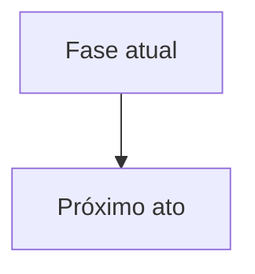

# 02 — Decomposição Penal (M1) — <CASO>

## 1 Síntese da Imputação

| Réu | Fato imputado | Tipificação | Fonte (id/fl.) | Confiança |
|---|---|---|---|---|

## 2 Teoria do Crime Estratificada

### 2.1 Fato típico

| Elemento | O que a acusação afirma | O que os autos demonstram (F#) | Lacuna ou vício | Confiança |
|---|---|---|---|---|
| Conduta (ação / omissão) | | | | |
| Resultado | | | | |
| Nexo causal e imputação objetiva | | | | |
| Tipicidade formal | | | | |
| Tipicidade material (lesividade / insignificância) | | | | |
| Tipicidade subjetiva (dolo / culpa / elemento subjetivo especial) | | | | |
| Erro de tipo (art. 20 CP) | | | | |

### 2.2 Ilicitude

| Excludente (art. 23 CP e supralegais) | Suporte fático (F#) | Avaliação | Confiança |
|---|---|---|---|

### 2.3 Culpabilidade

| Elemento | Suporte fático (F#) | Avaliação | Confiança |
|---|---|---|---|
| Imputabilidade (arts. 26 a 28 CP) | | | |
| Potencial consciência da ilicitude (art. 21 CP) | | | |
| Exigibilidade de conduta diversa (art. 22 CP) | | | |

### 2.4 Punibilidade

| Causa (art. 107 CP e leis especiais) | Situação | Fonte | Confiança |
|---|---|---|---|

### 2.5 Autoria e participação (art. 29 CP)

| Réu | Conduta individualizada na acusação | Prova de autoria (F#) | Avaliação | Confiança |
|---|---|---|---|---|

### 2.6 Qualificadoras, majorantes e agravantes imputadas

| Circunstância | Suporte fático (F#) | Avaliação | Confiança |
|---|---|---|---|

## 3 Pressupostos Processuais e Condições da Ação Penal

| Item | Situação | Fundamento | Confiança |
|---|---|---|---|
| Justa causa | | | |
| Legitimidade e representação / decadência | | | |
| Competência | | | |
| Litispendência / coisa julgada | | | |

## 4 Aptidão da Denúncia (arts. 41 e 395 CPP)

| Requisito | Atendido? | Observação | Fonte |
|---|---|---|---|
| Exposição do fato criminoso com todas as circunstâncias | | | |
| Qualificação do acusado | | | |
| Classificação do crime | | | |
| Rol de testemunhas | | | |
| Individualização da conduta de cada réu | | | |

## 5 Correlação Acusação-Sentença (arts. 383 e 384 CPP)

| Fato narrado na acusação | Fato que emerge da prova (F#) | Risco (emendatio / mutatio / nenhum) | Observação |
|---|---|---|---|

## 6 Provas — Licitude e Nulidades (triagem para /provas-nulidades)

| Prova | Vício potencial | Dispositivo | Consequência | Fonte (id/fl.) | Confiança |
|---|---|---|---|---|---|

## 7 Divergências com a Ficha e Contradições Relevantes

| Item | Ficha ou fonte A | Autos ou fonte B | Providência |
|---|---|---|---|

## 8 Fluxogramas

### 8.1 Modelo visual dos fatos

### 8.2 Próximos passos processuais

## 9 Perguntas Socráticas (M1 — autos)

| Q# | Prioridade (CRÍTICA / ALTA / COMPLEMENTAR) | Pergunta | Por que importa | Onde encontrar | Bloqueia (módulo) |
|---|---|---|---|---|---|
