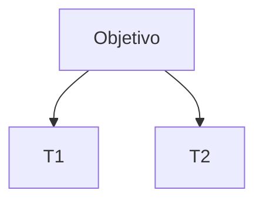

# 04 — Árvore de Teses e SWOT (M2) — <CASO>

## 1 Vetor de Objetivos e Diagnóstico de Base

<!-- Objetivos de 01 §2, respostas do Douglas no Portão 1 (gestao/status.md §6) e principais achados de 02 e 03, em prosa curta. -->

## 2 GENERATE_ARGUMENT_TREE — Árvore de Teses (ToT)

### 2.1 Quadro dos ramos

| ID | Tese | Natureza (preliminar / nulidade / absolutória / desclassificatória / dosimétrica / liberdade / negocial) | Fatos de suporte (F#) | Pedido pretendido | Skill de origem |
|---|---|---|---|---|---|

## 3 RUN_LEGAL_MAPPING_LOOP — Mapeamento em Quatro Planos

<!-- Uma subseção "### Tn — <tese>" por ramo, com a tabela abaixo e o silogismo (Premissa maior → Premissa menor → Conclusão). -->

| Plano | Conteúdo | Fonte | Confiança |
|---|---|---|---|
| Estrutural (CF, CP, CPP, lei especial) | | | |
| Dominante (STF, STJ, TJ e doutrina) | | | |
| Contextual (subsunção dos fatos atômicos F#) | | | |
| Garantista (presunção de inocência, in dubio pro reo, prova ilícita, convencionalidade) | | | |

## 4 Ramo Obrigatório — Solução Negociada (/negocial)

| Instituto | Cabível? | Requisitos e óbices | Vantagens | Riscos | Recomendação |
|---|---|---|---|---|---|

## 5 Ramo Obrigatório — Liberdade (/liberdade)

| Medida | Fundamento | Via (relaxamento / revogação / liberdade provisória / substituição por cautelar / HC) | Urgência | Recomendação |
|---|---|---|---|---|

## 6 EVALUATE_SWOT

| Tese | Forças | Fraquezas | Oportunidades | Ameaças |
|---|---|---|---|---|

## 7 Matriz de Riscos e Contingências

| Argumento provável da parte contrária ou do juízo | Tese afetada | Estratégia de neutralização |
|---|---|---|

## 8 Pauta de Pesquisa para o arpac-pesquisador

| Tese | Questão jurídica a pesquisar | Tribunais prioritários | Palavras-chave |
|---|---|---|---|

## 9 Perguntas Socráticas (M2)

| Q# | Prioridade (CRÍTICA / ALTA / COMPLEMENTAR) | Pergunta | Por que importa | Onde encontrar | Bloqueia (módulo) |
|---|---|---|---|---|---|
