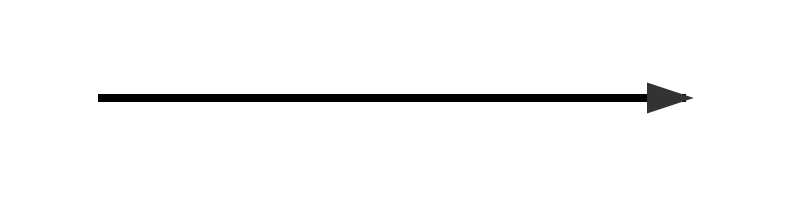

# Cronologia — <CASO>

<!-- Escrita exclusiva do arpac-auditor-autos. Lida pelo arpac-prazos-prescricao: as seções 2 e 3 são a base de cálculo de prazos e prescrição. Datas em DD/MM/AAAA. -->

## 1 Linha do Tempo

| # | Data | Evento | Tipo (FATO / ATO PROCESSUAL / PRISÃO / MARCO PRESCRICIONAL / INTIMAÇÃO) | Fonte (id/fl.) | Confiança |
|---|---|---|---|---|---|

## 2 Marcos da Prescrição (arts. 111, 116 e 117 CP)

| Marco | Data | Fonte (id/fl.) | Confiança |
|---|---|---|---|
| Data do fato / consumação (art. 111) | | | |
| Recebimento da denúncia ou queixa (art. 117, I) | | | |
| Pronúncia (art. 117, II) | | | |
| Decisão confirmatória da pronúncia (art. 117, III) | | | |
| Sentença ou acórdão condenatórios recorríveis (art. 117, IV) | | | |
| Início ou continuação do cumprimento da pena (art. 117, V) | | | |
| Causas suspensivas (art. 116 CP; art. 366 CPP; art. 89, § 6º, da Lei 9.099/95) | | | |

## 3 Intimações e Termos Iniciais de Prazo

| Ato intimado | Data da intimação ou ciência | Forma (pessoal / DJe / sistema / audiência / mandado) | Destinatário (réu / defensor) | Fonte (id/fl.) | Confiança |
|---|---|---|---|---|---|

## 4 Linha do Tempo Visual

